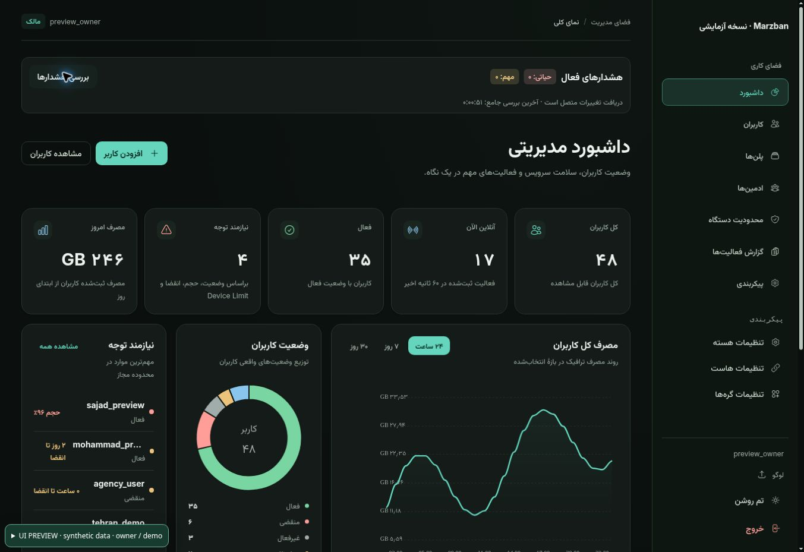

# Console UI review and deployment

Baseline: backend/CLI v1.1.21, source `270ffdddb8d1ac01b3c985dccc14058db27840e7`. UI identity: `ui-v1.1.22`. Target master: `167.233.62.226` only.

## Presentation coverage

All eight routes use one light/dark system: Dashboard, Users, Admins and accounting, Plans and Access Groups, Device Limits, Audit Logs, Settings and Login. Shared theme definitions cover hosts, inbounds, node management, core editor, user details, QR, bulk dialogs and confirmation/error/loading states. User lists now have mobile cards with the same guarded actions; desktop tables retain bounded horizontal scrolling. Dialog body/footer behavior and existing submit guards are retained.

Design sources: `src/index.scss`, `chakra.config.ts`, `src/design-system/Console.tsx`, and `design-system/marzban-console/MASTER.md`.

## Automated validation

- TypeScript and canonical Vite production build. Routes load on demand; no added runtime packages.
- `test-stage1-ui-contracts.cjs`, `test-hosts-form.cjs`, `test-autofill-contract.cjs`, `test-access-groups.cjs`, `test-admin-hierarchy-authorization.cjs`, v1.1.2/v1.1.3 regressions.
- `test-admin-form-submit.cjs`: real mutation hooks exercise pending, duplicate-submit prevention, error, retry and success.
- `test-ui-boundaries.cjs`: original request/query definitions, actions, disabled/hidden guards and options in 93 source files; SHA256 protection for 618 backend/API/context/hook/type/configuration files. Works in shallow CI checkouts.
- `test-ui-presentation.cjs`: 68 contrast checks across both themes, local licensed fonts and motion/touch rules.
- `test-ui-deploy.py`: exact preservation of existing Compose settings, replacement of only the UI mount, rejection of ambiguous configuration.
- Historical Admin UX assertions referenced a floating launcher and sections already absent in v1.1.21. Their baseline failure was reproduced in a detached original worktree; assertions now cover the current presentation while preserving policy/action checks.

## Browser review

The first checkpoint (`7bea0d6`) was served at `https://newmaster.javaher.shop:2087/dashboard/` against synthetic fixtures, isolated from the live database/API. Owner Dashboard, Users, Admins, Plans, Device Limits, Audit Logs and Settings rendered; dark/light desktop views and the 375px Admin creation modal were checked. Its persistent footer stayed inside the viewport. Hosts and Nodes dialogs opened. Synthetic form-only, plan-only and suspended Admin profiles showed the expected scoped actions and hid Owner infrastructure. A delegated manager could access Plans. The manager/worst fixture reproduced horizontal overflow from a long unbroken recent-user name; its flex child now has an explicit minimum width and a bounded, titled name, and text can break safely. Clickable dashboard lists also expose equivalent Enter/Space keyboard actions.

That review found light-theme badge/Plan contrast defects, fixed using semantic tokens. Responsive user cards, route loading, skip-link hash routing and stronger input borders were added afterward. The final candidate still requires its browser pass after the target Desktop Commander connection returns. Five role profiles and empty/one/huge/worst/loading/error fixtures and a 320/375/768/1024/1440 review canvas are prepared in `preview/server.cjs`. Physical phone testing has not been performed.

## Frontend-only deployment

Do not run a full backend upgrade for this presentation release. Keep the existing immutable v1.1.21 backend image, database and environment. `scripts/deploy-ui.py` downloads the exact reviewed commit, verifies a deterministic bundle SHA256, takes a static/Compose recovery snapshot, adds one read-only static mount and recreates only the panel container. It checks unchanged backend image, MySQL container and environment, verifies the served index and restores the original Compose on failure. It refuses another server or backend version.

The pinned mount is persistent across container recreation. A future frontend update must replace it using the reviewed deployment script. Removing that one mount restores the dashboard bundled with the backend image. No database restore or migration is involved.

Canonical build location (existing Vite 3 parity contract): `/home/runner/work/Marzban-v1/Marzban-v1/app/dashboard`; build with `VITE_BASE_API=/api/ npm run build`. Preserve the strict committed-build parity check.
